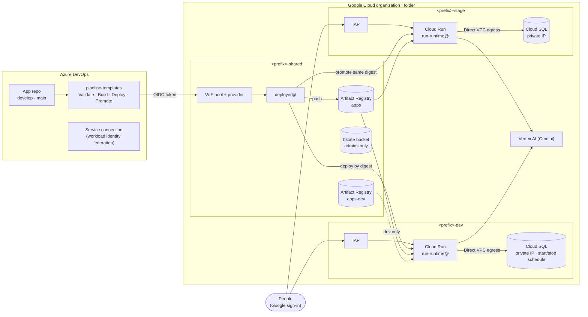

# GCP AI Platform Blueprint

<!-- ARCHITECTURE GIF: replace docs/architecture.gif to update the animation. -->


A reusable Terraform blueprint for a small **Google Cloud platform for AI apps and internal
demos** (portals, agents, prototypes built with AI coding tools), with **dev** and **stage**
environments and **Azure DevOps** pipelines that deploy **without any service account key**.

Apps run on Cloud Run behind IAP, talk to a private-IP-only Cloud SQL for PostgreSQL and call
Gemini on Vertex AI. Stage only ever receives the **exact image (same digest)** that already
ran in dev.

## Architecture



| Project | Contents |
|---|---|
| `<prefix>-shared` | Artifact Registry (`apps`, `apps-dev`), Terraform state bucket, `deployer@`, Workload Identity Federation pool for Azure DevOps |
| `<prefix>-dev` | VPC + Private Service Access, Cloud SQL (scheduled start/stop), Cloud Run with IAP, Secret Manager, `run-runtime@` |
| `<prefix>-stage` | Same as dev, read-only for developers, the demo environment for users |

Three groups drive all human access: **admins** (own the folder), **devs** (deploy and operate
in dev, read-only in stage) and **users** (reach stage apps through IAP).

## Key decisions and why

| Decision | Why |
|---|---|
| **Keyless Azure DevOps → GCP federation** ([details](docs/azure-devops-federation.md)) | No service account key to leak or rotate. Only one service connection of one organization can act as `deployer@`; the Entra app has no secret and no Azure role |
| **Two registries: `apps` and `apps-dev`** | Only the pipeline (`deployer@`) writes to `apps`, and stage only reads `apps`. Developers push manual builds to `apps-dev`, which only dev can pull, so a manual build can never reach stage |
| **Promotion of the same image by digest** | `main` never builds. The pipeline takes the merge commit's **second parent** (the develop commit), checks that dev runs exactly that commit's image from `apps`, and deploys the same `sha256` digest to stage. Squash/rebase merges are refused |
| **Required template + protected template repo** | Credentials are only issued to pipelines that extend the official template from `main`, which developers cannot modify |
| **IAP directly on Cloud Run** | No load balancer, certificate or DNS records; the Google-managed OAuth client handles sign-in. IAP covers every entry point, including the `run.app` URL |
| **Cloud SQL with private IP only** | No public address at all. Apps connect via Direct VPC egress with TLS enforced (`ENCRYPTED_ONLY`) |
| **Write-only database password** | Generated as an ephemeral value and sent through `password_wo`/`secret_data_wo`: never in the state or the plan. Rotation = bump a version number |
| **Org policy: no grants to default service accounts** | `iam.automaticIamGrantsForDefaultServiceAccounts` on the folder: nothing silently inherits `roles/editor`. Workloads use dedicated service accounts |
| **Scheduled start/stop of the dev database** | Cloud Scheduler flips `activationPolicy`; the instance is only billed during working hours. Terraform ignores the flag, so there is no drift |
| **State bucket readable by admins only** | Authoritative bucket IAM, plus a custom "bucket admin without data" role so Terraform keeps managing the bucket |
| **Additive IAM only (`*_iam_member`)** | Never overwrites bindings created by Google or other teams, including in an external Vertex AI project |
| **Layered rollout** (`enable_network` → `enable_sql` → `enable_iam` → `enable_run` → `enable_edge`) | Each layer is applied and validated before the next, without `-target` |
| **Scale to zero, no HA, shared-core SQL** | It is a dev/demo platform: low fixed cost over availability |

## Repository layout

```
infra/
├── bootstrap/        # folder, 3 projects, groups, org policy, state bucket, registries, deployer@, WIF
├── modules/
│   ├── project/      # project + APIs + labels
│   ├── network/      # custom VPC, subnet, Private Service Access
│   ├── cloudsql/     # Postgres 16, private IP, write-only password + secret
│   └── run-service/  # Cloud Run v2 service (Direct VPC egress, probes, IAP)
└── envs/
    ├── dev/          # layers 1-5 + start/stop schedule
    └── stage/        # same code, stage values
pipeline-templates/   # Azure DevOps template repo (Validate, Build, Deploy, Promote)
app-template/         # example app: Flask, Dockerfile, .dockerignore, azure-pipelines.yml
docs/                 # federation setup and generic runbooks
```

## Prerequisites

- A Google Cloud **organization** and a **billing account**. The identity running Terraform needs,
  at organization level: `roles/resourcemanager.folderCreator`,
  `roles/resourcemanager.projectCreator`, `roles/billing.user` and `roles/orgpolicy.policyAdmin`.
- To let Terraform create the groups: **Groups Admin** in the Google Workspace / Cloud Identity
  directory (or set `manage_groups = false` and create the three groups yourself).
- Terraform **>= 1.11** (write-only arguments), `gcloud`, Docker.
- `gcloud auth application-default login` with that identity.
- An **Azure DevOps** project where you are Project Administrator, and permission to create an
  app registration in the **Microsoft Entra** tenant connected to the organization.
- Two free private IP ranges per environment (a `/24` subnet and a `/16` for Private Service
  Access) that do not overlap with networks you connect to.

## Deploy to your own organization

> Run every `plan` and read it before `apply`. Never use `-auto-approve`.

1. **Org policies check.** List the effective policies
   (`gcloud org-policies list --organization=<org_id>`) and look for anything that blocks the
   plan, such as `iam.allowedPolicyMemberDomains`, `gcp.resourceLocations` or
   `run.allowedIngress`.

2. **Bootstrap (local state first).**

   ```bash
   cd infra/bootstrap
   cp terraform.tfvars.example terraform.tfvars   # fill in your values
   mv backend.tf backend.tf.off                    # the state bucket does not exist yet
   terraform init && terraform plan && terraform apply
   mv backend.tf.off backend.tf
   terraform init -migrate-state -backend-config="bucket=<prefix>-tfstate"
   ```

   The groups are created with you as OWNER (so you can read the state bucket). Add people to
   the groups through the console or admin.google.com: memberships are not managed by Terraform.
   For the Azure DevOps values, follow [docs/azure-devops-federation.md](docs/azure-devops-federation.md)
   first (you can apply the bootstrap once with placeholders and again with the real IDs).

3. **Validation image.** As an admin, build the example app once and push it to `apps`:

   ```bash
   IMG=<region>-docker.pkg.dev/<prefix>-shared/apps/hello
   gcloud auth configure-docker <region>-docker.pkg.dev
   docker build -t $IMG:manual app-template && docker push $IMG:manual
   gcloud artifacts docker images describe $IMG:manual --format="value(image_summary.digest)"
   ```

   Use `$IMG@<digest>` as `hello_image` in both environments.

4. **dev, layer by layer.**

   ```bash
   cd infra/envs/dev
   cp terraform.tfvars.example terraform.tfvars
   terraform init -backend-config="bucket=<prefix>-tfstate"
   ```

   Set `enable_network = true` → plan/apply; then `enable_sql`, `enable_iam`, `enable_run` and
   `enable_edge`, one at a time, checking each layer (VPC peering, instance `RUNNABLE`, IAM
   bindings, service health) before the next.

5. **stage.** Same as dev in `infra/envs/stage`.

6. **Azure DevOps.**
   - Create the `pipeline-templates` repository with the contents of
     [pipeline-templates/](pipeline-templates/) and fill
     [`platform-vars.yml`](pipeline-templates/templates/platform-vars.yml) using
     `terraform -chdir=infra/bootstrap output`.
   - Configure the protections listed in [pipeline-templates/README.md](pipeline-templates/README.md):
     branch policies (merge without fast-forward only), protected template repo, service
     connection not open to all pipelines, *Required template* check.
   - Create an app repository from [app-template/](app-template/) with `main` and `develop`,
     create its pipeline and authorize it on the service connection.

7. **End-to-end test.** Push to `develop` → the app is deployed to dev. Open a PR
   `develop → main`, complete it with *Merge (no fast-forward)* → the same digest lands in stage.
   Open the stage URL in a browser: Google sign-in, then `/api/health`, `/api/check/db` and
   `/api/check/vertex` should all answer `ok`. An account outside the groups must be denied.

### Runbooks

- [Rotate the database password](docs/runbooks/rotate-db-password.md)
- [Start and stop the dev database](docs/runbooks/start-stop-dev-database.md)
- [Restore a backup](docs/runbooks/restore-backup.md)
- [Semiannual review](docs/runbooks/semiannual-review.md)

## Limitations

**This is a development and demo platform, not a production one.**

- No high availability: zonal shared-core Cloud SQL, no read replicas, no point-in-time recovery
  (7 daily backups).
- No alerting, uptime checks or on-call: logs and metrics only.
- Apps are reached through `*.run.app` URLs with IAP; no custom domain, load balancer or Cloud
  Armor. IAP with the Google-managed OAuth client only supports browser sign-in, so
  service-to-service calls use internal APIs (`iap: false`) with IAM ID tokens.
- Cloud SQL has no public IP: connecting from a laptop needs a path into the VPC (e.g. a bastion
  with IAP TCP forwarding), which is not included.
- One region, one VPC per environment, no Shared VPC, no VPC Service Controls.
- The pipeline has no security scanning stage (SAST, image scanning); add your own.
- A production environment would need its own project, a promotion stage → prod by digest with
  manual approval, HA database, alerting and a security review.

## License

[Apache License 2.0](LICENSE).

---

## Resumo em português

**O que é:** um blueprint em Terraform de uma plataforma pequena no Google Cloud para apps e
demos de IA, com ambientes **dev** e **stage**, Cloud Run com IAP, Cloud SQL só com IP privado,
Vertex AI (Gemini) e pipelines do **Azure DevOps** que fazem deploy **sem chave de service
account**.

**Decisões principais:** federação do Azure DevOps sem chave; repositórios `apps` (só o
pipeline grava, stage só lê) e `apps-dev` (builds manuais, só dev); promoção para stage da
**mesma imagem por digest**, pelo segundo pai do merge, sem novo build; IAP direto no Cloud Run,
sem load balancer; Cloud SQL só com IP privado e senha *write-only*; org policy que impede
permissões automáticas nas contas de serviço padrão; banco de dev com liga/desliga agendado.

**Como usar:** preencha os `terraform.tfvars.example` (todos os valores são fictícios), rode o
`infra/bootstrap` com state local e migre para o bucket, depois `infra/envs/dev` e
`infra/envs/stage` camada por camada, e configure o repositório `pipeline-templates` e as
proteções no Azure DevOps.

**Limitações:** é um ambiente de desenvolvimento e demonstração, **não de produção**: sem alta
disponibilidade, sem alertas, sem domínio próprio e sem análise de segurança no pipeline.
