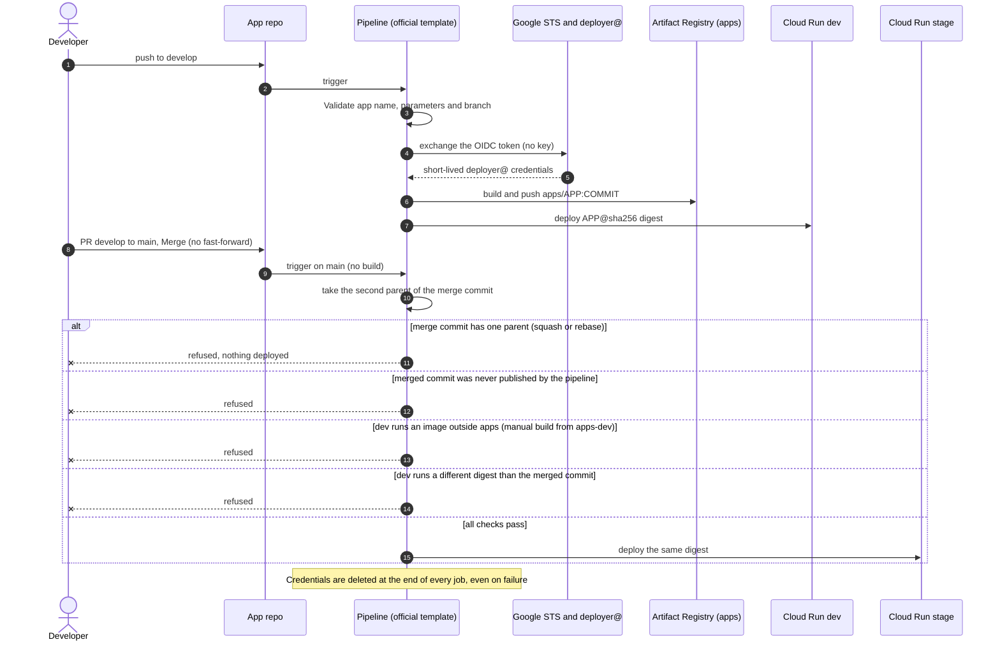

# GCP AI Platform Blueprint

🇺🇸 English · [🇧🇷 Português](README.pt-BR.md)

**A keyless, cost-aware Google Cloud platform for shipping AI apps from commit to demo, with
Azure DevOps pipelines.**

[](infra/)
[](https://cloud.google.com/)
[](pipeline-templates/)
[](infra/modules/run-service/)
[](app-template/)
[](LICENSE)

<!-- ARCHITECTURE GIF: replace docs/architecture.gif to update the animation. -->


## 💡 Why this exists

Teams want to ship AI apps, portals and agents fast. The usual shortcuts get them there, but
they leave a bill behind. A service account JSON key ends up in a pipeline variable. Someone
deploys from a laptop and nobody knows which image runs in the demo. Environments stay on all
night. An app goes public "just for the demo" with no sign-in. This blueprint takes those
shortcuts away by making the safe path the easy one.

## 🎯 Who is this for

- **Platform and DevOps teams** that need a safe default for AI apps.
- **IT leaders** who want to enable AI without losing governance.
- **Teams running Azure DevOps with Google Cloud.**

## ✨ Highlights

| Feature | What it means |
|---|---|
| **Zero service account keys** | Azure DevOps pipelines sign in through Workload Identity Federation. Only one service connection of one organization can act as the deployer |
| **Stage gets exactly what ran in dev** | `main` never builds. It promotes the same `sha256` digest that dev runs, or refuses |
| **Sign-in without a load balancer** | IAP directly on Cloud Run with the Google-managed OAuth client. No certificate, no DNS records |
| **Private database, secret-free state** | Cloud SQL with private IP only and TLS enforced. The password is write-only: never in the Terraform state or plan |
| **Pay for use** | Cloud Run scales to zero with request-based billing. The dev database stops at night and on weekends |
| **Manual builds can't reach stage** | Two registries: `apps` (pipeline only) and `apps-dev` (developers, dev only) |
| **Everything in Terraform** | Additive IAM only, three groups for all human access, and a layered rollout you can validate step by step |

## 🏗️ Architecture


| Project | Contents |
|---|---|
| `<prefix>-shared` | Artifact Registry (`apps`, `apps-dev`), Terraform state bucket, `deployer@`, Workload Identity Federation pool for Azure DevOps |
| `<prefix>-dev` | VPC + Private Service Access, Cloud SQL (scheduled start/stop), Cloud Run with IAP, Secret Manager, `run-runtime@` |
| `<prefix>-stage` | Same as dev, read-only for developers, the demo environment for users |

Three groups drive all human access: **admins** (own the folder), **devs** (deploy and operate
in dev, read-only in stage) and **users** (reach stage apps through IAP).

## 🔁 How a commit becomes a demo



The refusal messages and how to fix each one are in
[pipeline-templates/README.md](pipeline-templates/README.md).

## 🛡️ Security model

Defense in depth: each layer blocks something on its own.

| # | Layer | What it prevents | Where |
|---|---|---|---|
| 1 | Branch policy on `main`: PRs only, *Merge (no fast-forward)* only | Direct pushes; squash/rebase commits that never ran in dev | Azure DevOps settings ([documented](pipeline-templates/README.md)) |
| 2 | Protected `pipeline-templates` repo (required reviewers, *Deny* for contributors) | Developers editing the template that grants cloud access | Azure DevOps settings |
| 3 | Service connection not open to all pipelines | A new pipeline getting credentials without an admin's review | Azure DevOps settings |
| 4 | *Required template* check | Pipelines that do not extend the official template from `main` | Azure DevOps settings |
| 5 | Federation condition + `workloadIdentityUser` for one subject only | Other organizations or service connections acting as `deployer@` | [`infra/bootstrap/azdo.tf`](infra/bootstrap/azdo.tf) |
| 6 | Validate and Promote stages | Invalid parameters, wrong branch, single-parent commits, images outside `apps`, digest mismatch | [`pipeline-templates/templates/app.yml`](pipeline-templates/templates/app.yml) |
| 7 | Per-repository registry IAM | Developers writing to `apps`; stage pulling from `apps-dev` | [`infra/bootstrap/shared.tf`](infra/bootstrap/shared.tf), [`infra/envs/*/iam.tf`](infra/envs/dev/iam.tf) |
| 8 | Stage IAM: developers read-only, only the pipeline acts as `deployer@` | Direct deploys to stage; developers reading stage secrets or the database | [`infra/envs/*/iam.tf`](infra/envs/dev/iam.tf), [`infra/bootstrap/iam.tf`](infra/bootstrap/iam.tf) |
| 9 | IAP on Cloud Run, no `allUsers` invoker | Anonymous access to apps | [`infra/envs/*/edge.tf`](infra/envs/dev/edge.tf) |
| 10 | Org policy on the folder: no automatic grants to default service accounts | Workloads silently inheriting `roles/editor` | [`infra/bootstrap/policies.tf`](infra/bootstrap/policies.tf) |
| 11 | Private-IP-only Cloud SQL, TLS enforced, write-only password, state bucket for admins only | Database exposure on the internet; secrets leaking through the state | [`infra/modules/cloudsql`](infra/modules/cloudsql/), [`infra/bootstrap/shared.tf`](infra/bootstrap/shared.tf) |

**No layer relies on another one alone.** For example, if the template had a bug, the registry
IAM would still stop stage from pulling a manual build.

## ⚖️ Design decisions and trade-offs

| Decision | Why | Trade-off |
|---|---|---|
| Keyless Azure DevOps → GCP federation ([details](docs/azure-devops-federation.md)) | No key to leak or rotate; the Entra app has no secret and no Azure role | More moving parts (Entra app, service connection, WIF pool) and a token flow that is specific to Azure DevOps |
| Two registries: `apps` and `apps-dev` | A manual build can never become the stage image | Two repositories with different cleanup rules; developers cannot promote a manual build |
| Promotion by the merge commit's second parent and digest | Stage receives exactly what ran in dev, without a rebuild | `main` only accepts *Merge (no fast-forward)*; no hotfix straight to `main` |
| Required, protected template | Security logic stays out of app teams' reach | App teams cannot customize stages; template changes go through admins |
| IAP directly on Cloud Run | No load balancer, certificate or DNS | `*.run.app` URLs only; browser sign-in only, so service-to-service calls need internal APIs with IAM ID tokens |
| Cloud SQL with private IP only | No public database endpoint at all | No direct connection from a laptop without a path into the VPC |
| Write-only database password | Never in the state or the plan | Needs Terraform ≥ 1.11; rotation requires new revisions of running apps; the plan cannot detect password drift |
| Org policy: no default service account grants | Nothing silently gets `roles/editor` | Every workload needs explicit roles on a dedicated service account |
| Scheduled start/stop of the dev database | The dev instance runs only during working hours | Starting takes about 10-15 minutes; the backup window must fall while it runs |
| State bucket readable by admins only | The state is not readable by every project owner | A custom role is needed so Terraform keeps managing its own bucket; others cannot read outputs |
| Additive IAM only (`*_iam_member`) | Never overwrites bindings made by Google or other teams | Bindings added by hand are neither removed nor reported |
| Layered rollout (`enable_network` → … → `enable_edge`) | Each layer is applied and checked before the next, without `-target` | More plan/apply cycles on the first deployment |
| Scale to zero, zonal shared-core SQL, no HA | Low fixed cost for dev and demos | Cold starts; no failover |

## 💰 Cost-conscious by design

| Choice | Effect | Where |
|---|---|---|
| Cloud Run scales to zero, request-based CPU billing | Idle apps cost nothing to run | [`infra/modules/run-service`](infra/modules/run-service/), [`deploy.yml`](pipeline-templates/templates/steps/deploy.yml) |
| Dev database on a weekday schedule | The instance is stopped at night and on weekends | [`infra/envs/dev/main.tf`](infra/envs/dev/main.tf) |
| IAP directly on Cloud Run | No load balancer per environment | [`infra/envs/*/edge.tf`](infra/envs/dev/edge.tf) |
| Direct VPC egress | No Serverless VPC Access connector instances | [`infra/modules/run-service`](infra/modules/run-service/) |
| Shared-core, zonal Cloud SQL tiers | Smallest instances that fit dev and demo loads | [`terraform.tfvars.example`](infra/envs/dev/terraform.tfvars.example) |
| Registry cleanup policies | `apps` keeps 20 versions per image; `apps-dev` keeps 5 and deletes the rest after 7 days | [`infra/bootstrap/shared.tf`](infra/bootstrap/shared.tf) |
| Labels on Vertex AI calls (`environment`, `app`) | Model cost can be split per app and environment in billing reports | [`app-template/main.py`](app-template/main.py) |

## 📚 Lessons learned

These come from the real-world implementation this blueprint was derived from.

| Story | What happened | What fixed it |
|---|---|---|
| **The inherited Deny** | Administrators lost access to the template repository. They were in a team that belonged to Contributors, and an inherited *Deny* beats *Allow* in Azure DevOps. Making a group a team administrator also makes it a team member | Keep administrators out of Contributors, directly or through a team; use an empty group as team administrator |
| **The role combination that skipped the pipeline** | Leftovers from an earlier design let developers run a cloud build as the deploy identity, and write any image to the registry the pipeline promoted from. Together, that was a way to reach stage without the pipeline. The gap was found in a review, before any developer had access to the platform | Removed those roles; `apps` writable only by the deployer, `apps-dev` for developers, stage reads `apps` only, and the template refuses anything else |
| **The token that would not come** | The Azure DevOps `oidctoken` API returned *HTTP 400 "no explicit reference to service connection"* | A task in the job must reference the service connection. An `AzureCLI@2` task with `condition: false` does it without ever running |
| **The password that stayed warm** | After a password rotation, warm Cloud Run instances kept the old password, so new database connections failed until new instances started | `DB_PASSWORD_VERSION` forces a new revision for Terraform-managed services; a [runbook](docs/runbooks/rotate-db-password.md) covers the rest |
| **The bucket that locked out Terraform** | An authoritative IAM policy on a bucket removed the access Terraform itself needed to read it | A custom "bucket admin without object access" role for admins, included in the policy |

## 🚀 Quick start

```bash
# 1. Bootstrap: folder, projects, groups, registries, federation (local state first)
cd infra/bootstrap && cp terraform.tfvars.example terraform.tfvars   # edit values
mv backend.tf backend.tf.off && terraform init && terraform plan && terraform apply
mv backend.tf.off backend.tf && terraform init -migrate-state -backend-config="bucket=<prefix>-tfstate"

# 2. Environments, one layer at a time (enable_network → enable_sql → enable_iam → enable_run → enable_edge)
cd ../envs/dev && cp terraform.tfvars.example terraform.tfvars
terraform init -backend-config="bucket=<prefix>-tfstate" && terraform plan

# 3. Azure DevOps: publish pipeline-templates/, fill platform-vars.yml, create an app from app-template/
```

The full procedure, with prerequisites and checks, is below.

## Deploy to your own organization

### Prerequisites

- A Google Cloud **organization** and a **billing account**. The identity running Terraform needs,
  at organization level: `roles/resourcemanager.folderCreator`,
  `roles/resourcemanager.projectCreator`, `roles/billing.user` and `roles/orgpolicy.policyAdmin`.
- To let Terraform create the groups: **Groups Admin** in the Google Workspace / Cloud Identity
  directory (or set `manage_groups = false` and create the three groups yourself).
- Terraform **≥ 1.11** (write-only arguments), `gcloud`, Docker.
- `gcloud auth application-default login` with that identity.
- An **Azure DevOps** project where you are Project Administrator, and permission to create an
  app registration in the **Microsoft Entra** tenant connected to the organization.
- Two free private IP ranges per environment (a `/24` subnet and a `/16` for Private Service
  Access) that do not overlap with networks you connect to.

### Steps

> Run every `plan` and read it before `apply`. Never use `-auto-approve`.

1. **Org policies check.** List the effective policies
   (`gcloud org-policies list --organization=<org_id>`) and look for anything that blocks the
   plan, such as `iam.allowedPolicyMemberDomains`, `gcp.resourceLocations` or
   `run.allowedIngress`.

2. **Bootstrap (local state first).**

   ```bash
   cd infra/bootstrap
   cp terraform.tfvars.example terraform.tfvars   # fill in your values
   mv backend.tf backend.tf.off                    # the state bucket does not exist yet
   terraform init && terraform plan && terraform apply
   mv backend.tf.off backend.tf
   terraform init -migrate-state -backend-config="bucket=<prefix>-tfstate"
   ```

   The groups are created with you as OWNER (so you can read the state bucket). Add people to
   the groups through the console or admin.google.com: memberships are not managed by Terraform.
   For the Azure DevOps values, follow [docs/azure-devops-federation.md](docs/azure-devops-federation.md)
   first (you can apply the bootstrap once with placeholders and again with the real IDs).

3. **Validation image.** As an admin, build the example app once and push it to `apps`:

   ```bash
   IMG=<region>-docker.pkg.dev/<prefix>-shared/apps/hello
   gcloud auth configure-docker <region>-docker.pkg.dev
   docker build -t $IMG:manual app-template && docker push $IMG:manual
   gcloud artifacts docker images describe $IMG:manual --format="value(image_summary.digest)"
   ```

   Use `$IMG@<digest>` as `hello_image` in both environments.

4. **dev, layer by layer.**

   ```bash
   cd infra/envs/dev
   cp terraform.tfvars.example terraform.tfvars
   terraform init -backend-config="bucket=<prefix>-tfstate"
   ```

   Set `enable_network = true` → plan/apply; then `enable_sql`, `enable_iam`, `enable_run` and
   `enable_edge`, one at a time, checking each layer (VPC peering, instance `RUNNABLE`, IAM
   bindings, service health) before the next.

5. **stage.** Same as dev in `infra/envs/stage`.

6. **Azure DevOps.**
   - Create the `pipeline-templates` repository with the contents of
     [pipeline-templates/](pipeline-templates/) and fill
     [`platform-vars.yml`](pipeline-templates/templates/platform-vars.yml) using
     `terraform -chdir=infra/bootstrap output`.
   - Configure the protections listed in [pipeline-templates/README.md](pipeline-templates/README.md):
     branch policies (merge without fast-forward only), protected template repo, service
     connection not open to all pipelines, *Required template* check.
   - Create an app repository from [app-template/](app-template/) with `main` and `develop`,
     create its pipeline and authorize it on the service connection.

7. **End-to-end test.** Push to `develop` → the app is deployed to dev. Open a PR
   `develop → main`, complete it with *Merge (no fast-forward)* → the same digest lands in stage.
   Open the stage URL in a browser: Google sign-in, then `/api/health`, `/api/check/db` and
   `/api/check/vertex` should all answer `ok`. An account outside the groups must be denied.

## Repository layout

```
infra/
├── bootstrap/        # folder, 3 projects, groups, org policy, state bucket, registries, deployer@, WIF
├── modules/
│   ├── project/      # project + APIs + labels
│   ├── network/      # custom VPC, subnet, Private Service Access
│   ├── cloudsql/     # Postgres 16, private IP, write-only password + secret
│   └── run-service/  # Cloud Run v2 service (Direct VPC egress, probes, IAP)
└── envs/
    ├── dev/          # layers 1-5 + start/stop schedule
    └── stage/        # same code, stage values
pipeline-templates/   # Azure DevOps template repo (Validate, Build, Deploy, Promote)
app-template/         # example app: Flask, Dockerfile, .dockerignore, azure-pipelines.yml
docs/                 # federation setup, generic runbooks, architecture animation
```

## Runbooks

| Runbook | When |
|---|---|
| [Rotate the database password](docs/runbooks/rotate-db-password.md) | Periodically, or after a suspected leak |
| [Start and stop the dev database](docs/runbooks/start-stop-dev-database.md) | Working outside the schedule, or changing it |
| [Restore a backup](docs/runbooks/restore-backup.md) | Testing backups, recovering data, or a lost database |
| [Semiannual review](docs/runbooks/semiannual-review.md) | Every six months: access, pipelines, drift, cost |

## 🧭 Limitations and roadmap

**This is a development and demo platform, not a production one.**

**Validation status.** This blueprint was derived from a real deployment that was built and
tested end to end. This generic version has been checked with `terraform fmt -check`,
`terraform validate` (passing in `bootstrap`, `dev` and `stage`), YAML lint and a secret scan,
but **has not yet been applied end to end in a new organization**. The pipeline template
**has not run in this form**: it was rewritten from the tested behavior, so expect to debug the
first runs.

| Limitation | Detail |
|---|---|
| No high availability | Zonal shared-core Cloud SQL, no replicas, no point-in-time recovery (7 daily backups) |
| No alerting | Logs and metrics only; no uptime checks or on-call |
| No custom domain | `*.run.app` URLs with IAP; no load balancer or Cloud Armor. Browser sign-in only, so service-to-service calls use internal APIs (`iap: false`) with IAM ID tokens |
| No laptop access to the database | Cloud SQL has no public IP; a path into the VPC (e.g. a bastion with IAP TCP forwarding) is not included |
| Simple network | One region, one VPC per environment, no Shared VPC, no VPC Service Controls |
| No security scanning | The pipeline has no SAST or image scanning stage |

**Roadmap** (not implemented):

| Item | Idea |
|---|---|
| Production environment | A `prod` project with the same modules, promoted from stage by digest with manual approval, HA database |
| Alerting | Uptime checks, 5xx/latency alerts, database and budget alerts with a notification channel |
| Security scanning | SAST and container image scanning as a pipeline stage |
| Policy as code | Automated checks of Terraform and IAM against written policies before apply |

## 👤 About the author

Built by **Kelsen Lima**, Head of IT, based on a real-world implementation.
*Governed AI. Measurable Impact.*

[LinkedIn](https://www.linkedin.com/in/kelsenlima) ·
[Blog](https://planningit.wordpress.com) ·
[GitHub](https://github.com/kelsenlima)

If this blueprint helps you, star the repo or connect with me on LinkedIn: I'd like to hear how
you adapted it.

## License

[Apache License 2.0](LICENSE).

