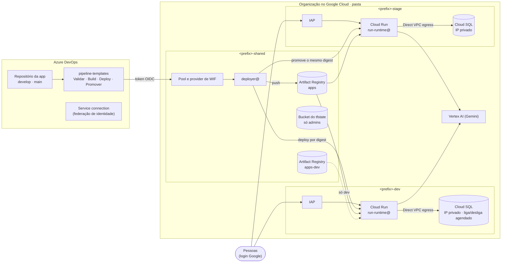
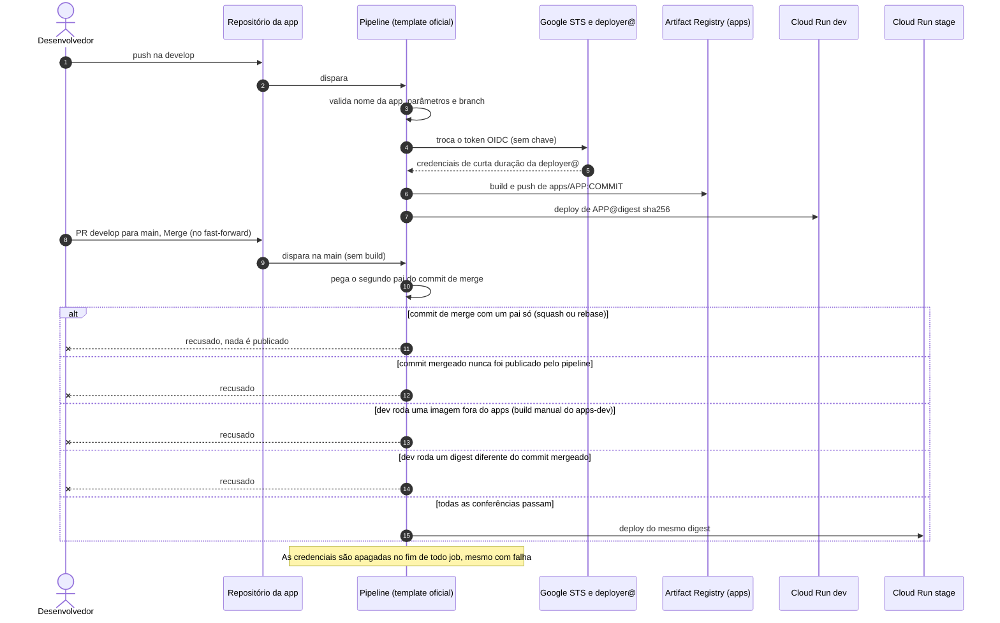

# GCP AI Platform Blueprint

[🇺🇸 English](README.md) · 🇧🇷 Português

**Uma plataforma no Google Cloud sem chaves e atenta ao custo, para levar apps de IA do commit
à demo, com pipelines do Azure DevOps.**

[](infra/)
[](https://cloud.google.com/)
[](pipeline-templates/)
[](infra/modules/run-service/)
[](app-template/)
[](LICENSE)

<!-- GIF DA ARQUITETURA: substitua docs/architecture.gif para atualizar a animação. -->


## 💡 Por que este projeto existe

Os times querem publicar apps, portais e agentes de IA rápido. Os atalhos de sempre chegam lá,
mas deixam a conta para depois. Uma chave JSON de service account vai parar numa variável do
pipeline. Alguém faz deploy do próprio notebook e ninguém sabe qual imagem está rodando na demo.
Ambientes ficam ligados a noite inteira. Uma app fica pública "só para a demo", sem login. Este
blueprint tira esses atalhos do caminho, fazendo do caminho seguro o caminho mais fácil.

## 🎯 Para quem é

- **Times de plataforma e DevOps** que precisam de um padrão seguro para apps de IA.
- **Líderes de TI** que querem habilitar a IA sem perder a governança.
- **Times que usam Azure DevOps com Google Cloud.**

## ✨ Destaques

| Recurso | O que significa |
|---|---|
| **Zero chaves de service account** | Os pipelines do Azure DevOps entram por Workload Identity Federation. Só uma service connection de uma organização pode agir como o deployer |
| **Stage recebe exatamente o que rodou em dev** | A `main` nunca faz build. Ela promove o mesmo digest `sha256` que roda em dev, ou recusa |
| **Login sem load balancer** | IAP direto no Cloud Run, com o OAuth client gerenciado pelo Google. Sem certificado e sem registros de DNS |
| **Banco privado, state sem segredos** | Cloud SQL só com IP privado e TLS obrigatório. A senha é *write-only*: nunca aparece no state nem no plan do Terraform |
| **Pague pelo uso** | O Cloud Run escala a zero, com cobrança por requisição. O banco de dev desliga à noite e nos fins de semana |
| **Build manual não chega a stage** | Dois repositórios de imagens: `apps` (só o pipeline) e `apps-dev` (desenvolvedores, só dev) |
| **Tudo em Terraform** | IAM só aditivo, três grupos para todo acesso de pessoas e uma implantação em camadas que dá para validar passo a passo |

## 🏗️ Arquitetura



| Projeto | Conteúdo |
|---|---|
| `<prefix>-shared` | Artifact Registry (`apps`, `apps-dev`), bucket do state do Terraform, `deployer@`, pool de Workload Identity Federation para o Azure DevOps |
| `<prefix>-dev` | VPC + Private Service Access, Cloud SQL (liga/desliga agendado), Cloud Run com IAP, Secret Manager, `run-runtime@` |
| `<prefix>-stage` | Igual a dev, só leitura para os desenvolvedores; é o ambiente de demonstração para os usuários |

Três grupos controlam todo o acesso de pessoas: **admins** (donos da pasta), **devs** (deploy e
operação em dev, só leitura em stage) e **users** (acessam as apps de stage pelo IAP).

## 🔁 Do commit à demo



As mensagens de recusa e como resolver cada uma estão em
[pipeline-templates/README.md](pipeline-templates/README.md).

## 🛡️ Modelo de segurança

Defesa em camadas: cada camada bloqueia algo por conta própria.

| # | Camada | O que impede | Onde |
|---|---|---|---|
| 1 | Branch policy na `main`: só por PR, só *Merge (no fast-forward)* | Push direto; commits de squash ou rebase que nunca rodaram em dev | Configuração do Azure DevOps ([documentada](pipeline-templates/README.md)) |
| 2 | Repositório `pipeline-templates` protegido (revisores obrigatórios, *Deny* para contributors) | Desenvolvedores alterarem o template que dá acesso à nuvem | Configuração do Azure DevOps |
| 3 | Service connection não liberada para todos os pipelines | Um pipeline novo receber credenciais sem a revisão de um admin | Configuração do Azure DevOps |
| 4 | Check *Required template* | Pipelines que não estendem o template oficial da `main` | Configuração do Azure DevOps |
| 5 | Condição na federação + `workloadIdentityUser` para um único subject | Outras organizações ou service connections agirem como `deployer@` | [`infra/bootstrap/azdo.tf`](infra/bootstrap/azdo.tf) |
| 6 | Stages Validar e Promover | Parâmetros inválidos, branch errada, commits com um pai só, imagens fora do `apps`, digest diferente | [`pipeline-templates/templates/app.yml`](pipeline-templates/templates/app.yml) |
| 7 | IAM por repositório no registry | Desenvolvedores gravarem no `apps`; stage puxar imagens do `apps-dev` | [`infra/bootstrap/shared.tf`](infra/bootstrap/shared.tf), [`infra/envs/*/iam.tf`](infra/envs/dev/iam.tf) |
| 8 | IAM de stage: desenvolvedores só leem, só o pipeline age como `deployer@` | Deploy direto em stage; desenvolvedores lendo secrets ou o banco de stage | [`infra/envs/*/iam.tf`](infra/envs/dev/iam.tf), [`infra/bootstrap/iam.tf`](infra/bootstrap/iam.tf) |
| 9 | IAP no Cloud Run, sem `allUsers` como invoker | Acesso anônimo às apps | [`infra/envs/*/edge.tf`](infra/envs/dev/edge.tf) |
| 10 | Org policy na pasta: sem permissões automáticas para as contas de serviço padrão | Workloads herdando `roles/editor` sem ninguém perceber | [`infra/bootstrap/policies.tf`](infra/bootstrap/policies.tf) |
| 11 | Cloud SQL só com IP privado, TLS obrigatório, senha *write-only*, bucket do state só para admins | Banco exposto na internet; segredos vazando pelo state | [`infra/modules/cloudsql`](infra/modules/cloudsql/), [`infra/bootstrap/shared.tf`](infra/bootstrap/shared.tf) |

**Nenhuma camada depende só de outra.** Por exemplo, se o template tivesse um bug, o IAM do
registry ainda impediria stage de puxar um build manual.

## ⚖️ Decisões de design e trade-offs

| Decisão | Por quê | Trade-off |
|---|---|---|
| Federação Azure DevOps → GCP sem chave ([detalhes](docs/azure-devops-federation.md)) | Nenhuma chave para vazar ou rotacionar; a app do Entra não tem secret nem papel no Azure | Mais peças (app do Entra, service connection, pool de WIF) e um fluxo de token específico do Azure DevOps |
| Dois repositórios: `apps` e `apps-dev` | Um build manual nunca vira a imagem de stage | Dois repositórios com regras de limpeza diferentes; desenvolvedores não conseguem promover um build manual |
| Promoção pelo segundo pai do merge e pelo digest | Stage recebe exatamente o que rodou em dev, sem novo build | A `main` só aceita *Merge (no fast-forward)*; não dá para fazer hotfix direto na `main` |
| Template obrigatório e protegido | A lógica de segurança fica fora do alcance dos times de app | Os times de app não personalizam os stages; mudanças no template passam pelos admins |
| IAP direto no Cloud Run | Sem load balancer, certificado nem DNS | Só URLs `*.run.app`; login só pelo navegador, então chamadas entre serviços precisam de APIs internas com ID tokens do IAM |
| Cloud SQL só com IP privado | Nenhum endpoint público do banco | Sem conexão direta do notebook sem um caminho até a VPC |
| Senha do banco *write-only* | Nunca aparece no state nem no plan | Exige Terraform ≥ 1.11; a rotação exige revisões novas das apps em execução; o plan não detecta drift da senha |
| Org policy: sem permissões para as contas de serviço padrão | Nada recebe `roles/editor` sem ninguém perceber | Todo workload precisa de papéis explícitos numa service account dedicada |
| Banco de dev com liga/desliga agendado | A instância de dev só roda no horário de trabalho | Ligar leva cerca de 10 a 15 minutos; o horário do backup precisa cair com a instância ligada |
| Bucket do state legível só por admins | O state não fica aberto a todo owner de projeto | É preciso um papel customizado para o Terraform continuar gerenciando o próprio bucket; os outros não leem os outputs |
| IAM só aditivo (`*_iam_member`) | Nunca sobrescreve permissões criadas pelo Google ou por outros times | Permissões dadas à mão não são removidas nem apontadas |
| Implantação em camadas (`enable_network` → … → `enable_edge`) | Cada camada é aplicada e conferida antes da próxima, sem `-target` | Mais ciclos de plan e apply na primeira implantação |
| Escala a zero, Cloud SQL zonal shared-core, sem HA | Custo fixo baixo para dev e demos | Cold starts; sem failover |

## 💰 Atento ao custo desde o desenho

| Escolha | Efeito | Onde |
|---|---|---|
| Cloud Run escala a zero, CPU cobrada por requisição | Apps paradas não custam nada para rodar | [`infra/modules/run-service`](infra/modules/run-service/), [`deploy.yml`](pipeline-templates/templates/steps/deploy.yml) |
| Banco de dev com agenda em dias úteis | A instância fica desligada à noite e nos fins de semana | [`infra/envs/dev/main.tf`](infra/envs/dev/main.tf) |
| IAP direto no Cloud Run | Nenhum load balancer por ambiente | [`infra/envs/*/edge.tf`](infra/envs/dev/edge.tf) |
| Direct VPC egress | Nenhuma instância de conector Serverless VPC Access | [`infra/modules/run-service`](infra/modules/run-service/) |
| Cloud SQL shared-core e zonal | As menores instâncias que atendem dev e demos | [`terraform.tfvars.example`](infra/envs/dev/terraform.tfvars.example) |
| Políticas de limpeza do registry | O `apps` guarda 20 versões por imagem; o `apps-dev` guarda 5 e apaga o resto depois de 7 dias | [`infra/bootstrap/shared.tf`](infra/bootstrap/shared.tf) |
| Labels nas chamadas ao Vertex AI (`environment`, `app`) | Dá para separar o custo dos modelos por app e por ambiente nos relatórios de faturamento | [`app-template/main.py`](app-template/main.py) |

## 📚 Lições aprendidas

Vêm da implementação real que deu origem a este blueprint.

| História | O que aconteceu | O que resolveu |
|---|---|---|
| **O Deny herdado** | Os administradores perderam o acesso ao repositório de templates. Eles estavam num time que fazia parte de Contributors, e no Azure DevOps um *Deny* herdado vence o *Allow*. Tornar um grupo administrador de um time também o torna membro do time | Manter os administradores fora de Contributors, direta ou indiretamente; usar um grupo vazio como administrador do time |
| **A combinação de papéis que pulava o pipeline** | Sobras de um desenho anterior deixavam os desenvolvedores rodar um build na nuvem como a identidade de deploy, e gravar qualquer imagem no registry de onde o pipeline promovia. Juntas, essas permissões eram um caminho até stage sem passar pelo pipeline. A brecha foi encontrada numa revisão, antes de qualquer desenvolvedor ter acesso à plataforma | Os papéis foram removidos; o `apps` aceita gravação só do deployer, o `apps-dev` fica para os desenvolvedores, stage lê só o `apps` e o template recusa qualquer outra coisa |
| **O token que não vinha** | A API `oidctoken` do Azure DevOps respondia *HTTP 400 "no explicit reference to service connection"* | Uma tarefa do job precisa referenciar a service connection. Uma tarefa `AzureCLI@2` com `condition: false` faz isso sem nunca executar |
| **A senha que ficou aquecida** | Depois de uma rotação de senha, as instâncias aquecidas do Cloud Run continuaram com a senha antiga, e as conexões novas com o banco falharam até instâncias novas subirem | `DB_PASSWORD_VERSION` força uma revisão nova nos serviços gerenciados pelo Terraform; um [runbook](docs/runbooks/rotate-db-password.md) cobre o resto |
| **O bucket que trancou o Terraform** | Uma política de IAM autoritativa num bucket removeu o acesso de que o próprio Terraform precisava para lê-lo | Um papel customizado de "gestão de bucket sem acesso a objetos" para os admins, incluído na política |

## 🚀 Início rápido

```bash
# 1. Bootstrap: pasta, projetos, grupos, registries, federação (primeiro com state local)
cd infra/bootstrap && cp terraform.tfvars.example terraform.tfvars   # edite os valores
mv backend.tf backend.tf.off && terraform init && terraform plan && terraform apply
mv backend.tf.off backend.tf && terraform init -migrate-state -backend-config="bucket=<prefix>-tfstate"

# 2. Ambientes, uma camada por vez (enable_network → enable_sql → enable_iam → enable_run → enable_edge)
cd ../envs/dev && cp terraform.tfvars.example terraform.tfvars
terraform init -backend-config="bucket=<prefix>-tfstate" && terraform plan

# 3. Azure DevOps: publique pipeline-templates/, preencha platform-vars.yml, crie uma app a partir de app-template/
```

O procedimento completo, com pré-requisitos e conferências, está logo abaixo.

## Implantar na sua própria organização

### Pré-requisitos

- Uma **organização** no Google Cloud e uma **conta de faturamento**. A identidade que roda o
  Terraform precisa, no nível da organização, de `roles/resourcemanager.folderCreator`,
  `roles/resourcemanager.projectCreator`, `roles/billing.user` e `roles/orgpolicy.policyAdmin`.
- Para o Terraform criar os grupos: **Groups Admin** no diretório do Google Workspace / Cloud
  Identity (ou use `manage_groups = false` e crie os três grupos você mesmo).
- Terraform **≥ 1.11** (argumentos *write-only*), `gcloud` e Docker.
- `gcloud auth application-default login` com essa identidade.
- Um projeto no **Azure DevOps** em que você seja Project Administrator, e permissão para criar
  um app registration no tenant do **Microsoft Entra** ligado à organização.
- Duas faixas de IP privadas livres por ambiente (uma subnet `/24` e uma `/16` para o Private
  Service Access) que não se sobreponham às redes com que você se conecta.

### Passo a passo

> Rode sempre o `plan` e leia antes do `apply`. Nunca use `-auto-approve`.

1. **Conferir as org policies.** Liste as políticas efetivas
   (`gcloud org-policies list --organization=<org_id>`) e procure qualquer uma que bloqueie o
   plano, como `iam.allowedPolicyMemberDomains`, `gcp.resourceLocations` ou
   `run.allowedIngress`.

2. **Bootstrap (primeiro com state local).**

   ```bash
   cd infra/bootstrap
   cp terraform.tfvars.example terraform.tfvars   # preencha com os seus valores
   mv backend.tf backend.tf.off                    # o bucket do state ainda não existe
   terraform init && terraform plan && terraform apply
   mv backend.tf.off backend.tf
   terraform init -migrate-state -backend-config="bucket=<prefix>-tfstate"
   ```

   Os grupos são criados com você como OWNER (assim você consegue ler o bucket do state).
   Adicione as pessoas aos grupos pelo console ou pelo admin.google.com: os membros não são
   gerenciados pelo Terraform. Para os valores do Azure DevOps, siga antes o
   [docs/azure-devops-federation.md](docs/azure-devops-federation.md) (dá para aplicar o
   bootstrap uma vez com valores provisórios e de novo com os IDs reais).

3. **Imagem de validação.** Como admin, faça o build da app de exemplo uma vez e envie para o
   `apps`:

   ```bash
   IMG=<region>-docker.pkg.dev/<prefix>-shared/apps/hello
   gcloud auth configure-docker <region>-docker.pkg.dev
   docker build -t $IMG:manual app-template && docker push $IMG:manual
   gcloud artifacts docker images describe $IMG:manual --format="value(image_summary.digest)"
   ```

   Use `$IMG@<digest>` como `hello_image` nos dois ambientes.

4. **dev, camada por camada.**

   ```bash
   cd infra/envs/dev
   cp terraform.tfvars.example terraform.tfvars
   terraform init -backend-config="bucket=<prefix>-tfstate"
   ```

   Ligue `enable_network = true` → plan/apply; depois `enable_sql`, `enable_iam`, `enable_run` e
   `enable_edge`, um de cada vez, conferindo cada camada (peering da VPC, instância `RUNNABLE`,
   permissões de IAM, saúde do serviço) antes da próxima.

5. **stage.** O mesmo que dev, em `infra/envs/stage`.

6. **Azure DevOps.**
   - Crie o repositório `pipeline-templates` com o conteúdo de
     [pipeline-templates/](pipeline-templates/) e preencha o
     [`platform-vars.yml`](pipeline-templates/templates/platform-vars.yml) com
     `terraform -chdir=infra/bootstrap output`.
   - Configure as proteções listadas em [pipeline-templates/README.md](pipeline-templates/README.md):
     branch policies (só merge sem fast-forward), repositório de templates protegido, service
     connection não liberada para todos os pipelines e o check *Required template*.
   - Crie um repositório de app a partir de [app-template/](app-template/), com `main` e
     `develop`, crie o pipeline dele e autorize-o na service connection.

7. **Teste de ponta a ponta.** Push na `develop` → a app é publicada em dev. Abra um PR
   `develop → main` e conclua com *Merge (no fast-forward)* → o mesmo digest chega a stage. Abra a
   URL de stage no navegador: login Google, depois `/api/health`, `/api/check/db` e
   `/api/check/vertex` devem responder `ok`. Uma conta fora dos grupos precisa ser barrada.

## Estrutura do repositório

```
infra/
├── bootstrap/        # pasta, 3 projetos, grupos, org policy, bucket do state, registries, deployer@, WIF
├── modules/
│   ├── project/      # projeto + APIs + labels
│   ├── network/      # VPC personalizada, subnet, Private Service Access
│   ├── cloudsql/     # Postgres 16, IP privado, senha write-only + secret
│   └── run-service/  # serviço Cloud Run v2 (Direct VPC egress, probes, IAP)
└── envs/
    ├── dev/          # camadas 1 a 5 + liga/desliga agendado
    └── stage/        # mesmo código, valores de stage
pipeline-templates/   # repositório de templates do Azure DevOps (Validar, Build, Deploy, Promover)
app-template/         # app de exemplo: Flask, Dockerfile, .dockerignore, azure-pipelines.yml
docs/                 # federação, runbooks genéricos, animação da arquitetura
```

## Runbooks

| Runbook | Quando |
|---|---|
| [Rotacionar a senha do banco](docs/runbooks/rotate-db-password.md) | Periodicamente, ou depois de suspeita de vazamento |
| [Ligar e desligar o banco de dev](docs/runbooks/start-stop-dev-database.md) | Para trabalhar fora do horário, ou para mudar a agenda |
| [Restaurar um backup](docs/runbooks/restore-backup.md) | Testar backups, recuperar dados ou um banco perdido |
| [Revisão semestral](docs/runbooks/semiannual-review.md) | A cada seis meses: acessos, pipelines, drift, custo |

Os runbooks estão em inglês.

## 🧭 Limitações e roadmap

**Esta é uma plataforma de desenvolvimento e demonstração, não de produção.**

**Estado da validação.** Este blueprint foi derivado de uma implantação real, construída e
testada de ponta a ponta. Esta versão genérica foi conferida com `terraform fmt -check`,
`terraform validate` (passando em `bootstrap`, `dev` e `stage`), lint dos YAML e varredura de
segredos, mas **ainda não foi aplicada de ponta a ponta numa organização nova**. O template do
pipeline **não rodou nesta forma**: foi reescrito a partir do comportamento testado, então
espere ajustes nas primeiras execuções.

| Limitação | Detalhe |
|---|---|
| Sem alta disponibilidade | Cloud SQL zonal shared-core, sem réplicas, sem point-in-time recovery (7 backups diários) |
| Sem alertas | Só logs e métricas; sem uptime checks nem plantão |
| Sem domínio próprio | URLs `*.run.app` com IAP; sem load balancer nem Cloud Armor. Login só pelo navegador, então chamadas entre serviços usam APIs internas (`iap: false`) com ID tokens do IAM |
| Sem acesso ao banco pelo notebook | O Cloud SQL não tem IP público; um caminho até a VPC (por exemplo, um bastião com IAP TCP forwarding) não está incluído |
| Rede simples | Uma região, uma VPC por ambiente, sem Shared VPC, sem VPC Service Controls |
| Sem análise de segurança | O pipeline não tem stage de SAST nem de scan de imagens |

**Roadmap** (não implementado):

| Item | Ideia |
|---|---|
| Ambiente de produção | Um projeto `prod` com os mesmos módulos, promovido de stage por digest com aprovação manual, banco com HA |
| Alertas | Uptime checks, alertas de 5xx e latência, alertas do banco e de orçamento, com canal de notificação |
| Análise de segurança | SAST e scan de imagens de container como um stage do pipeline |
| Policy as code | Conferência automática do Terraform e do IAM contra políticas escritas, antes do apply |

## 👤 Sobre o autor

Criado por **Kelsen Lima**, Head of IT, a partir de uma implementação real.
*Governed AI. Measurable Impact.*

[LinkedIn](https://www.linkedin.com/in/kelsenlima) ·
[Blog](https://planningit.wordpress.com) ·
[GitHub](https://github.com/kelsenlima)

Se este blueprint for útil para você, deixe uma estrela no repositório ou me chame no LinkedIn:
quero saber como você o adaptou.

## Licença

[Apache License 2.0](LICENSE).
