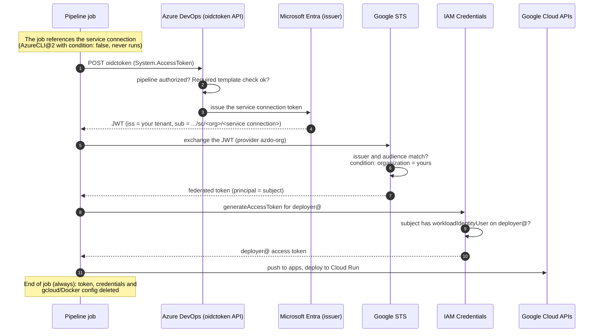

# Azure DevOps → Google Cloud federation (keyless)

The pipelines authenticate to Google Cloud as `deployer@<prefix>-shared` through Workload
Identity Federation. No service account key exists anywhere.

## Pieces

| Piece | Where | What it is |
|---|---|---|
| App registration | Microsoft Entra | Single-tenant, **no secret, no role in Azure, no API permission**. It only holds the federated credential of the service connection |
| Service connection | Azure DevOps project | Azure Resource Manager, *workload identity federation (manual)*. **Never share it with other projects**: the token carries the organization and the service connection, not the project |
| Pool `azure-devops`, provider `azdo-org` | `<prefix>-shared` ([`infra/bootstrap/azdo.tf`](../infra/bootstrap/azdo.tf)) | Accepts the Entra issuer of your tenant, the configured audience and **only tokens from your organization** |
| `roles/iam.workloadIdentityUser` | `deployer@` | Only for the subject `<organization-id>/<service-connection-id>` |

## Setup

1. **Entra**: create an app registration (single-tenant). Do not create a secret, do not
   assign roles, do not add API permissions.
2. **Azure DevOps**: *Project settings → Service connections → New → Azure Resource Manager →
   Workload identity federation (manual)*. Note the **issuer** and **subject** it shows.
   Scope it to any subscription you can read (it is metadata only; the connection is never used
   to log in to Azure). Do **not** grant access to all pipelines.
3. **Entra**: on the app registration, *Certificates & secrets → Federated credentials → Add*,
   using the issuer and subject from step 2.
4. Copy into `infra/bootstrap/terraform.tfvars`: tenant ID, organization ID (the GUID inside the
   subject), service connection ID and name.
5. **Audience**: run any pipeline that references the service connection and decode one token
   (or read the `aud` the service connection shows). Use exactly that value in
   `azdo_token_audiences`. Depending on how the token is issued it is either
   `api://AzureADTokenExchange` or the application ID of the Azure token exchange app.
6. `terraform apply` in `infra/bootstrap`, then fill
   [`pipeline-templates/templates/platform-vars.yml`](../pipeline-templates/templates/platform-vars.yml)
   with `terraform output -raw workload_identity_provider`.

## Non-obvious behavior

- The `oidctoken` API **only issues a token if a task in the job references the service
  connection**. Without it: `HTTP 400 "no explicit reference to service connection"`. The
  template references it with an `AzureCLI@2` task that has `condition: false`. The reference
  is also what makes the service connection checks apply to the job.
- The token does not identify the Azure DevOps project. Project isolation comes from the
  service connection belonging to a single project.
- `google.subject` is limited to 127 characters, shorter than the full `sub`; the mapping keeps
  only `<organization-id>/<service-connection-id>`.
- A new service connection created in the same organization can still exchange its token at
  STS, but it gets a principal with **no** permissions. Restrict who can create service
  connections (Endpoint Creators) to administrators.
