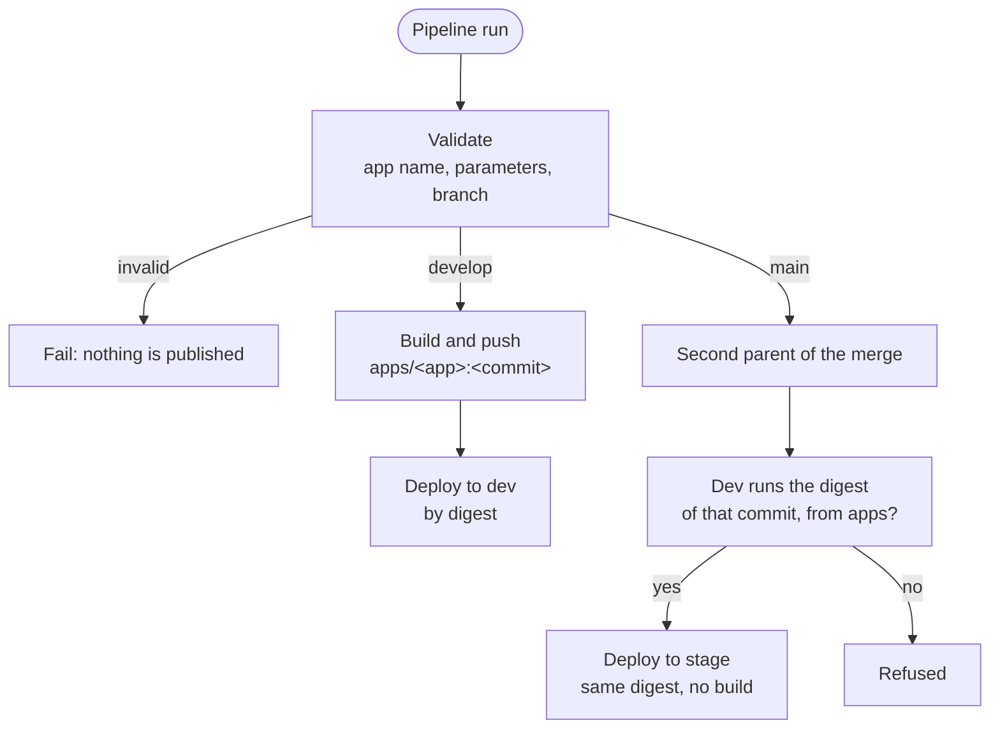

# pipeline-templates

Contents of the `pipeline-templates` repository in your Azure DevOps project. Every app
pipeline extends `templates/app.yml`; the service connection only hands out Google Cloud
credentials to pipelines that do so.

```
templates/
├── app.yml              # stages: Validate → Build → Deploy to dev | Promote to stage
├── platform-vars.yml    # prefix, region, service connection, WIF provider (fill once)
└── steps/
    ├── gcp-auth.yml     # keyless login as deployer@ (oidctoken + STS)
    ├── gcp-cleanup.yml  # always deletes token and credentials
    └── deploy.yml       # gcloud run deploy, always by digest
```

## Flow



| Refusal | Why | Fix |
|---|---|---|
| `commit ... on main is not a merge` | The PR was completed with squash or rebase: the commit never ran in dev | New PR develop → main with *Merge (no fast-forward)* |
| `the merged commit ... was never published` | The develop pipeline for that commit did not finish or failed | Wait or fix develop, then re-run the pipeline on main |
| `... in dev does not run a pipeline image` | Dev runs a manual build from `apps-dev` | Push to develop so the pipeline redeploys, then re-run on main |
| `dev runs sha256:..., but the merged commit is ...` | A newer commit is in dev, or dev was changed by hand | Re-run develop for the merged commit, or open a new PR |

## Protections to configure in Azure DevOps

| # | Setting | Prevents |
|---|---|---|
| 1 | Branch policy on `main` of every repository: PRs only, *Merge (no fast-forward)* only | Direct pushes; squash/rebase commits that never ran in dev |
| 2 | `pipeline-templates`: required reviewers (administrators) on `main`, *Deny* for Contributors on Contribute, Force push, Edit policies, Bypass policies and Create branch | Developers changing the template that grants Google Cloud access, or leaving parallel templates in other branches |
| 3 | Service connection **not** open to all pipelines; each pipeline authorized by an admin | A new pipeline getting credentials without review |
| 4 | *Required template* check on the service connection: `<project>/pipeline-templates`, `refs/heads/main`, `templates/app.yml` | Pipelines that do not extend the official template (including a modified template in another branch) |

On the Google Cloud side, the same goal is enforced again: only `deployer@` writes to `apps`,
stage only reads `apps`, developers are read-only in stage and nobody else can act as
`deployer@`. No single layer is trusted alone.

> In Azure DevOps, an inherited *Deny* wins over *Allow*. Keep administrators out of
> Contributors (directly or through a team), or they lose access to `pipeline-templates` too.
